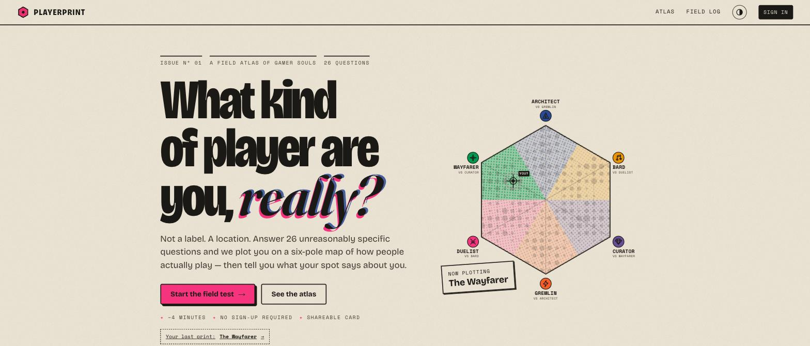
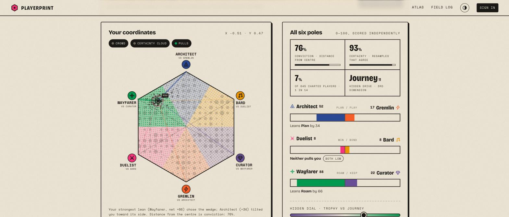
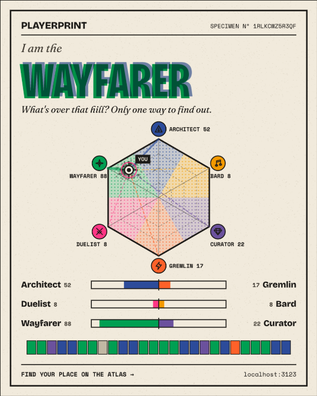

# PLAYERPRINT: a field atlas of gamer souls

A 26-question gamer personality quiz that doesn't give you a label. It plots you as a **location** on a six-pole hexagon atlas. Each result comes with a breakdown of all six poles, a written reading, a confidence cloud, a downloadable 1080×1350 share card, a stateless share link and friend comparison. Accounts are optional. Signing in adds a private **field log** that tracks how your print drifts between retakes.

The visual identity is a risograph zine: paper grain, six fluoro inks, halftone dots and misregistered overprints. It comes in a day print and a night print.

**Zero npm dependencies.** Node's standard library (`node:http`, `node:sqlite`, `node:crypto`) plus vanilla ES modules. No build step. The whole frontend is about 52 KB brotli-compressed.

| Home | Results | Share card |
|---|---|---|
|  |  |  |

---

## Run it (under 1 minute)

**Requirements:** Node.js **22.5+** (recommended: uses built-in SQLite). Node **18.17+** also works and falls back to a JSON-file store automatically.

```bash
cd playerprint
npm start            # no `npm install` needed — there are no dependencies
```

Open **http://localhost:3000**.

On first boot the server creates `data/playerprint.db`, runs the migrations, and seeds the atlas with 640 simulated players. It also creates a demo account so you can try the signed-in features right away:

> **username:** `demo` · **password:** `playerprint`
> (or click **"Use the demo account"** in the sign-in dialog)

The demo account has four past runs showing a drift from *The Curator* to *The Sequence Breaker*.

### With Docker

```bash
docker build -t playerprint .
docker run -p 3000:3000 -v playerprint-data:/data playerprint
```

### Scripts

| Command | What it does |
|---|---|
| `npm start` | Start the server (migrates and seeds automatically on first boot) |
| `npm run dev` | Start with `--watch` auto-restart |
| `npm run migrate` | Apply pending schema migrations explicitly |
| `npm run seed` | Add another batch of simulated players (and the demo user if missing) |
| `npm run reset` | Wipe `data/` and reseed from scratch |
| `npm test` | 28 tests: engine properties + full API integration, run against **both** storage adapters |
| `npm run calibrate` | Monte-Carlo report used to tune the scoring curve |

### Environment variables (all optional)

Set them in the shell or copy `.env.example` to `.env`. The `.env` file is read natively, with no dotenv package.

| Variable | Default | Purpose |
|---|---|---|
| `PORT` | `3000` | HTTP port |
| `HOST` | `0.0.0.0` | Bind address |
| `DATA_DIR` | `data` | Where the SQLite DB (or JSON fallback) lives |
| `STORE` | `auto` | `auto` \| `sqlite` \| `json` |
| `SECURE_COOKIES` | `0` | Set `1` behind HTTPS so the session cookie is `Secure` |
| `SESSION_DAYS` | `30` | Session lifetime |
| `SEED` | `1` | Seed simulated players + demo user on first boot (`0` to disable) |
| `SEED_PLAYERS` | `640` | How many simulated players to seed |
| `PUBLIC_URL` | request host | Absolute origin used in Open Graph URLs |

There are **no external paid APIs**. The only external request is Google Fonts, and the CSS falls back to system fonts if it's unreachable.

---

## What's in it

**The quiz**
- 26 questions in three formats: scenarios (4 options), *VS* duels (2 options) and five-stop spectrum sliders. The tone is meant to be fun to answer, not clinical.
- A live mini-atlas in the sidebar moves your dot as you answer, and a 26-bar "playerprint" strip fills in with the colour of each answer's pole.
- Full keyboard support (`1`–`5`, `A`–`D`, `←`, `→`). Keystrokes typed during transitions are never dropped.
- Progress is saved locally, so a refresh resumes where you left off.

**Results**
- **Interactive plane:** hover regions for descriptions and click them to inspect. Toggle layers for the population *crowd* (halftone density), the *certainty cloud* (160 bootstrap resamples), *pulls* (tethers to all six poles, thickness ∝ score), *my runs* (trajectory) and *friend*.
- **Six-pole breakdown:** three bipolar bars, conviction, certainty, rarity ("1 in 14 players"), and the hidden Trophy ↔ Journey dial.
- **Written reading:** archetype prose, hybrid blend, an axis-by-axis summary, *paradox* paragraphs (both ends of a pair high), *void* paragraphs (both low), the hidden drive, certainty commentary and integrity checks. It also lists strengths, blind spots, party role, best co-op partner, natural nemesis and games to try.
- **Sharing:** a canvas-rendered 1080×1350 specimen card (PNG download), the native share sheet with the image attached where supported, a copyable link, and per-result Open Graph tags rendered server-side.
- **Friend compare:** paste any PLAYERPRINT link to overlay their dot and get a chemistry score and verdict.

**Signed-in extras**
- Every run is saved to a private **field log**: a drift trajectory across the atlas, nameable runs ("Animal Crossing era"), deletion, and a side-by-side diff of any two runs.
- The results page gains a ghost marker for your previous run plus per-pole deltas ("since last run: Gremlin ▲ +47").
- **Guest → account claim:** finish as a guest, sign up later, and the anonymous atlas entry you created is *adopted* rather than duplicated, so population stats never double-count you.

**Also:** a population **atlas** page, a **methodology** page (`/about`), a day/night print toggle, a responsive layout down to 320px, reduced-motion support and accessible controls.

---

## The classification algorithm

Full write-up in the app at `/about`. The engine lives in [`shared/engine.js`](shared/engine.js) and is the *same file* in the browser and on the server.

1. **Six poles in three opposing pairs.** Architect ↔ Gremlin (*Plan vs Play*), Duelist ↔ Bard (*Win vs Bond*), Wayfarer ↔ Curator (*Roam vs Keep*). Around the hexagon the poles alternate between two hidden families, Trophy (A·C·D) and Journey (B·G·W). That's the dimension any 3-axis → 2D map loses, so we surface it as the "hidden drive" instead of discarding it.
2. **Range-normalised scoring.** Each option carries sparse weights (sometimes negative). Each pole is scored against the min/max that was *achievable* on the questions answered, so uneven question coverage can't bias a pole. Poles are independent, which is what makes paradoxes and voids detectable.
3. **Pole-dominance projection.** A linear projection has an aliasing bug: strong Architect + strong Curator lands in the *Bard* wedge, because vectors 120° apart sum to the one between them. Instead, the strongest net lean picks the wedge, the other two tilt the dot within ±28°, and distance from the centre is conviction. A property test verifies that **the dot always sits in the wedge its title names.**
4. **Titles.** 6 pure + 12 hybrids (any two non-opposite poles) + the rare centre "Omnivore" = 19 prints.
5. **Certainty via bootstrap.** 160 resamples of your answers, seeded deterministically from your answers, so the cloud is identical on every device. Certainty is the share of resamples that stay in your region.
6. **Calibration.** `npm run calibrate` simulates uniform-random clickers and latent-taste personas through the real question bank. Gain and curve are tuned so random clickers huddle near the centre while committed players reach the rim.
7. **Integrity checks.** Answer slots were rebalanced so no archetype clusters in one position. Picking the same slot ≥80% of the time (0.002% of random runs) or parking every slider on "Torn" is gently called out in the reading.

---

## Architecture

```
playerprint/
├── shared/            ← isomorphic: imported by browser AND server
│   ├── engine.js      questions, scoring, projection, bootstrap, share codes
│   └── content.js     archetype copy + deterministic insight generator
├── server/
│   ├── index.js       boot: config → store → migrate → seed-if-empty → listen
│   ├── app.js         routes, security headers, SPA shell w/ per-result OG tags
│   ├── http.js        tiny router, JSON body limits, cookies, HttpError
│   ├── auth.js        scrypt hashing, opaque server-side sessions
│   ├── static.js      static files: ETag/304, brotli+gzip cache, traversal guard
│   ├── ratelimit.js   fixed-window per-IP limiter (auth / results / writes)
│   ├── seed.js        simulated population + demo account
│   ├── simulate.js    latent-taste softmax respondents (seeding + calibration)
│   └── db/
│       ├── index.js   adapter selection (sqlite → json fallback)
│       ├── sqlite.js  node:sqlite repository (WAL, prepared statements)
│       ├── jsonstore.js  same interface, atomic file writes
│       └── migrations.js ordered, recorded, transactional migrations
├── public/            vanilla ES modules, no build step
│   ├── js/app.js      router + masthead     js/plane.js  SVG atlas component
│   ├── js/card.js     canvas share card     js/views/*   home, quiz, results, log, atlas, about
│   └── css/app.css    risograph design system (tokens, light + dark)
├── scripts/           migrate, seed, calibrate, cross-platform test runner
└── tests/             node:test suites
```

**Key decisions**
- **The share code *is* the result.** 26 answers pack base-5 into a ~12-character base-36 code (`/r/1rlkcwz5r3qf`). Links are stateless, work without a database, and can't be forged into impossible scores, because the server re-derives everything from the answers. The DB stores the code as the canonical record, plus derived columns for fast listing and stats.
- **One engine, two runtimes.** The client scores instantly (live preview, offline-capable results). The server re-scores authoritatively for storage, stats and Open Graph tags.
- **Storage behind a repository interface.** SQLite (built into Node) by default, with a JSON-file adapter when it's unavailable. The API test suite runs against both.

### Database schema (SQLite)

```sql
users    (id PK, username UNIQUE COLLATE NOCASE, pass_hash, created_at)
sessions (token_hash PK, user_id → users ON DELETE CASCADE, created_at, expires_at)
results  (id PK, public_id UNIQUE, user_id → users NULL, code, version,
          title_key, primary_id, x, y, scores JSON, is_seed, created_at, label)
schema_migrations (id PK, name, applied_at)
-- indexes: sessions(user_id), sessions(expires_at), results(user_id, created_at), results(title_key)
```

### API

| Method | Path | Auth | Description |
|---|---|---|---|
| GET | `/api/health` | — | Liveness + active store |
| GET | `/api/me` | — | Current user or `null` |
| POST | `/api/auth/register` | — | `{username, password}` → 201, sets session cookie |
| POST | `/api/auth/login` | — | `{username, password}` → sets session cookie |
| POST | `/api/auth/logout` | — | Revokes the session |
| POST | `/api/results` | optional | `{code, label?, claim?}`. Guests feed the anonymous atlas; users also save to their log. Idempotent for 10 min. `claim` adopts your own guest row |
| GET | `/api/results` | ✔ | Your field log |
| PATCH | `/api/results/:id` | ✔ | `{label}`: name a run |
| DELETE | `/api/results/:id` | ✔ | Delete one of your runs |
| GET | `/api/stats` | — | Population: total, per-title counts, 20×20 density grid (cached 15 s) |
| GET | `/r/:code` | — | SPA shell with per-result `<title>` / Open Graph tags |

### Security

- Passwords: `scrypt` (N=16384) with per-user salt, timing-safe compare, and a dummy hash on unknown users so login timing doesn't reveal which accounts exist.
- Sessions: a random 256-bit token in an `HttpOnly; SameSite=Lax` cookie. Only its SHA-256 is stored, so a leaked DB can't be replayed. Expired sessions are purged hourly.
- CSRF defence in depth: SameSite cookie, JSON-only bodies (415 otherwise), and same-origin `Origin` checks on writes.
- Strict CSP (`script-src 'self'`, no inline scripts), `nosniff`, `frame-ancestors 'self'`, body-size limits, per-IP rate limits, a path-traversal guard, and no user HTML ever rendered (text nodes only).
- Privacy: no trackers or analytics. Accounts need only a username. The atlas stores coordinates and a title, nothing identifying.

---

## Testing

```bash
npm test
```

- **Engine:** codes round-trip on 2,000 random answer sets; malformed codes are rejected; scores stay in [0,1]; the dot stays inside the hexagon; the dot sits in its title's wedge (3,000 personas); pure players classify to their own pole at ≥90% certainty and are never flagged as button-mashers; the bootstrap is deterministic; all 19 titles produce complete readings.
- **API (×2 adapters):** auth lifecycle, case-insensitive usernames, guest claim without double counting, idempotent submits, labels, ownership checks on delete, validation (400/413/415), cross-origin rejection, cookie flags, OG tag injection, ETag/304, traversal and 404/405 handling.
